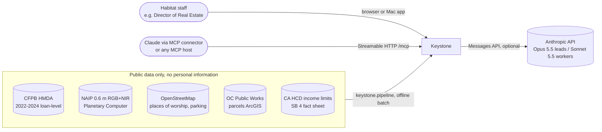
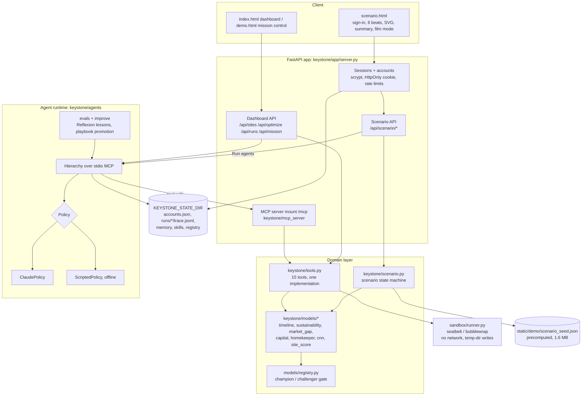
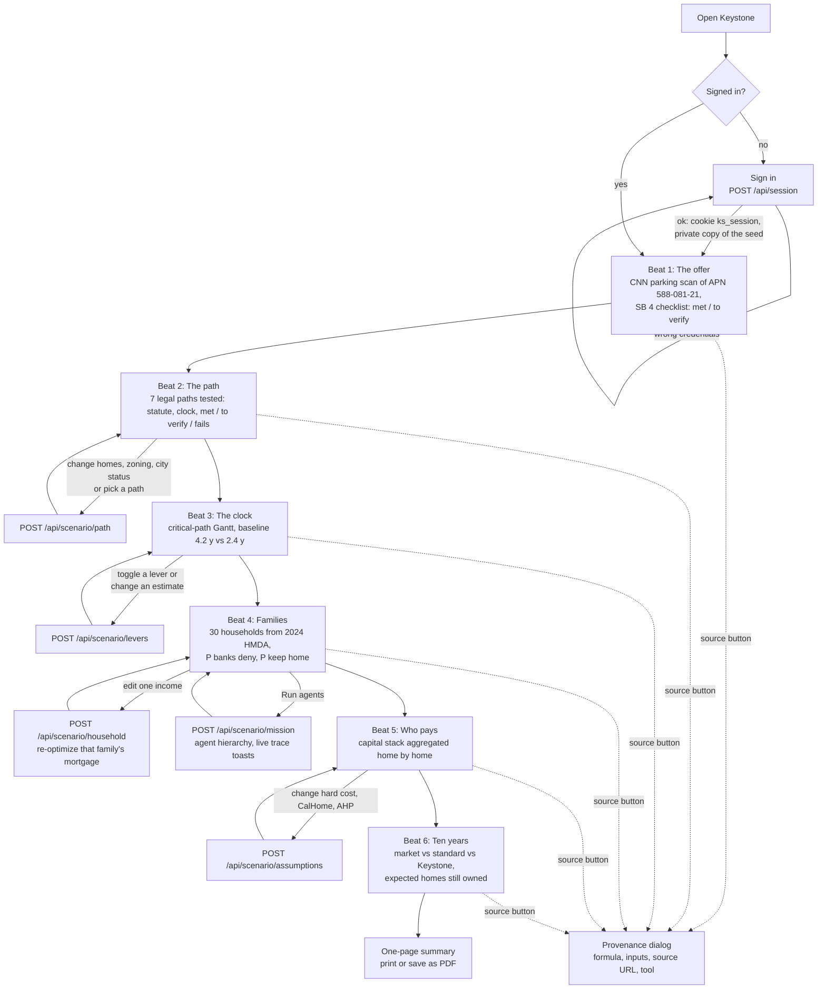
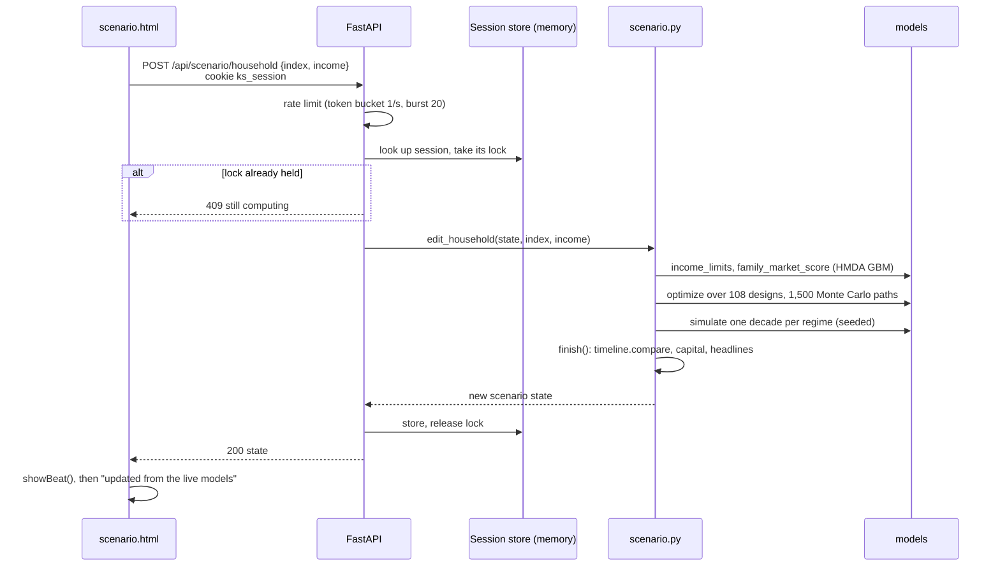
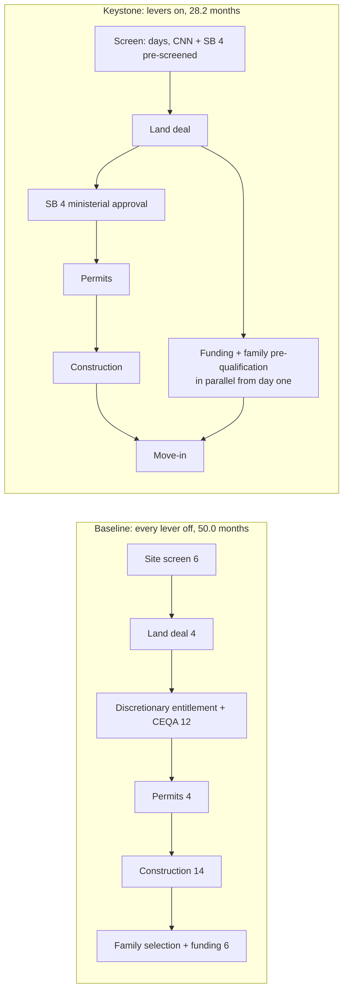
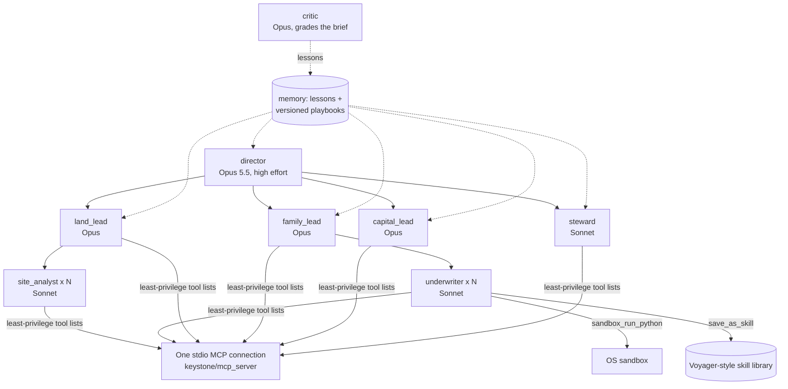
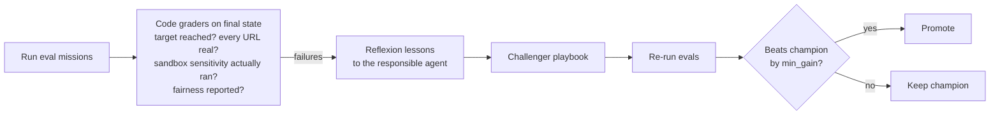
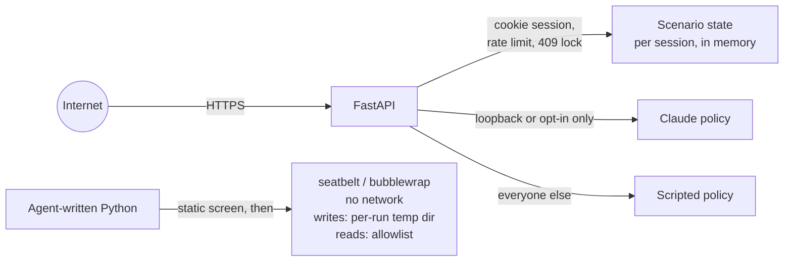
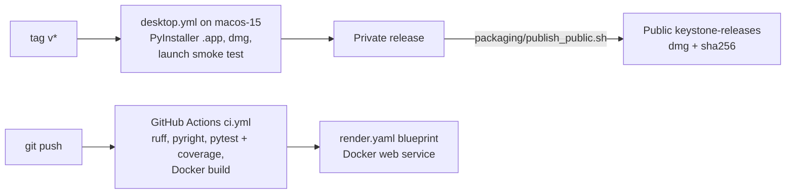
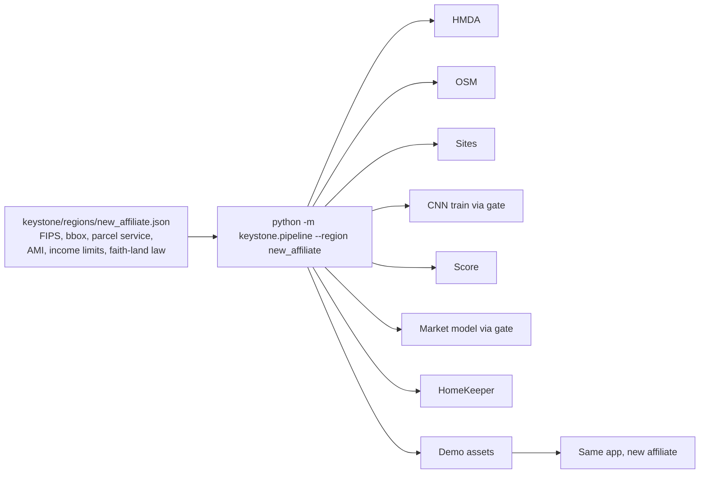

# Keystone: system design

Keystone is an agentic operating system for Habitat for Humanity of Orange County's *Keys to 100*. This document is for engineers: what the parts are, how a request flows through them, where state lives, what is trusted, and how it scales to the next region.

The demo surface is the **Crossline scenario** (Impact Lab Lane 2, *Clear it*): a church offers its parking lot; can 30 families move in within two years?

---

## 1. Context

Everything a user sees is computed from public data that the pipeline has already ingested. At request time the only external calls are optional: Claude for agent missions, and map tiles in the browser.

---

## 2. Containers

| Container | Code | Responsibility |
|---|---|---|
| Scenario app | `keystone/app/scenario.html` | Single-file UI. Six beats (offer, path, clock, families, who pays, ten years), live controls, provenance dialogs, one-page summary, frame-exact film mode. |
| HTTP server | `keystone/app/server.py` | FastAPI. Sessions, scenario API, dashboard API, mission runner, mounts the MCP server and static assets. |
| Scenario engine | `keystone/scenario.py` | Builds and edits one scenario: households, levers, assumptions, timeline, capital, headlines with provenance. |
| Tools | `keystone/tools.py` | One implementation behind three front doors: MCP, the sandbox, the offline planner. Namespaced `<domain>_<action>`, compact JSON, no side effects outside `artifacts/`. |
| Models | `keystone/models/` | The quantitative core (section 5). |
| Agent runtime | `keystone/agents/` | Hierarchical agents over one MCP connection, two interchangeable policies, graders, self-improvement. |
| Sandbox | `keystone/sandbox/runner.py` | Runs agent-written Python under an OS sandbox. |
| Pipeline | `keystone/pipeline.py` | Idempotent ingestion per region: public data in, scored sites, trained models and demo assets out. |
| Desktop | `keystone/desktop.py` | pywebview shell around the same server, opens `/scenario`, demo sign-in on. |

---

## 3. User flow (the Crossline scenario)

Every headline number carries `value, label, formula, inputs, source, tool`, so the "source" button on any beat answers *where did this come from* without leaving the app.

---

## 4. Request lifecycle: an edit

Pydantic bounds reject bad input before any model runs (income must be positive, household index 0-29, estimates 0.25-60 months, lever keys are a `Literal`).

---

## 5. The models

| Model | File | Method | Data | Output used in the scenario |
|---|---|---|---|---|
| Parking-lot CNN | `models/cnn.py` | Compact U-Net on 4-band NAIP + NDVI, weakly supervised by OSM `amenity=parking` polygons | NAIP 0.6 m, OSM | m² of surface parking on a faith-owned parcel, so how many townhomes fit. Champion IoU 0.544, pixel accuracy 0.849. |
| Site score | `models/site_score.py`, `data/sites.py` | OSM places of worship joined to county parcels, scored by the CNN | OSM, OC parcels | Ranked SB 4 inventory, the Crossline parcel. |
| Market gap | `models/market_gap.py` | `HistGradientBoostingClassifier`, protected attributes excluded from features but kept for a calibration fairness audit | HMDA OC 2022-2024 | P(conventional lender denies) per family. AUC 0.779, Brier 0.067, max group calibration gap 0.069, n_test 15,489. |
| Sustainability | `models/sustainability.py` | Two layers: vectorized monthly Monte Carlo of household cash flow over 10 years (job loss, repairs, insurance shocks); outer search for the cheapest design meeting P(sustained) | Labelled assumptions, cited literature | Each family's mortgage design and P(keeps home 10 y). Common random numbers, so designs differ by design, not luck. |
| Capital | `models/capital.py` | Unit cost x underwriting x funding stack | Cost assumptions, CalHome, AHP | Philanthropy gap, summed only over real per-home shortfalls. |
| Legal paths | `models/pathways.py` | Seven paths (SB 4, SB 35/423, SB 684, SB 9 duplex, SB 9 split, ADU, rezone), each a list of statutory tests returning met / to verify / fails; ranked viable first, ministerial before discretionary | HCD SB 4 fact sheet, HCD SB 35 Guidelines, Impact Lab DATA-SOURCES (current statute numbering) | Recommended path (SB 4 for Crossline), its clock and open checks; the chosen path names the approval phase on the clock. |
| Timeline | `models/timeline.py` | Phases as a dependency graph; the clock is the critical path | HCD SB 4, SF Planning, Pew 2024, Terner Center 2025, Impact Lab brief | 4.2 y baseline vs 2.4 y; savings per lever. |
| HomeKeeper | `models/homekeeper.py` | 100 synthetic families from real HMDA incomes, same shocks under three regimes | HMDA | Homes still owned after 10 years, watchlist. |

### Timeline engine (the *Clear it* core)

`schedule()` computes earliest start and finish per phase and walks back from the latest finish to get the critical path. `compare()` returns the baseline, the chosen setting, total months saved and each lever's saving alone (instant screen 5.8, SB 4 ministerial 6.0, parallel funding 10.0 months). Every phase carries a source URL or is labelled `estimate`. A test enforces that.

---

## 6. Agent runtime

- **Orchestrator-workers.** Agents with children get a `delegate` tool. Parallel `delegate` calls in one turn fan out with `asyncio`, max depth 3.
- **Least privilege.** `agents/specs.py` lists each agent's tools. A site analyst cannot run the sandbox, and an underwriter cannot touch the capital model.
- **Two policies, one hierarchy.** `ClaudePolicy` uses the Messages API with adaptive thinking. `ScriptedPolicy` makes the same kinds of tool calls deterministically, so the trace, graders and improvement loop run with no credentials. Remote visitors to a hosted scenario always get the scripted policy (no paid calls from the internet). Claude runs only for loopback or with `KEYSTONE_SCENARIO_CLAUDE=1`.
- **Trace.** Every event goes to `runs/<id>/trace.jsonl`. The dashboard renders it as a tree, and the scenario turns it into toasts.

### Self-improvement and model governance

Agents may *recommend* retraining. Only `models/registry.py` decides promotion: a challenger must beat the champion on the same frozen holdout by `min_gain` and must not widen the guardrails. For the HMDA model the guardrail is the fairness gap, checked with a paired bootstrap. The pipeline re-runs through the same gate, so it never silently replaces a better model.

---

## 7. Security and trust boundaries

| Concern | Control |
|---|---|
| Passwords | scrypt (n=2^14) in `accounts.json` under the state dir, never stored in plain text (tested). |
| Sessions | Random token in an `HttpOnly` cookie; in-memory, capped at 500; each session gets a private copy of the scenario, so users never see each other's edits (tested). |
| Demo login | Off unless `KEYSTONE_DEMO_LOGIN=1` (tested). On in the Mac app and the Render blueprint. |
| Abuse | Token-bucket rate limit per client; per-session lock returns 409 while a recompute runs. |
| Cost | Remote scenario missions are forced onto the offline policy (tested). |
| Agent code | OS sandbox with no network and no secrets; the static screen is a speed bump, the OS profile is the boundary. |
| Data | Public data only; families are synthetic, sampled from aggregate HMDA incomes. Protected attributes are never features. |
| Citations | Graders fail any brief citing a URL that is not in the verified research list. |

---

## 8. State and storage

| What | Where | Lifetime |
|---|---|---|
| Accounts | `$KEYSTONE_STATE_DIR/accounts.json` | Persistent |
| Sessions and scenario copies | Server memory | Process lifetime; nothing a demo user changes is saved |
| Agent runs | `$KEYSTONE_STATE_DIR/runs/<id>/trace.jsonl` | Persistent |
| Lessons, playbooks, skills | `$KEYSTONE_STATE_DIR` | Persistent, per deployment |
| Model registry and weights | `artifacts/<region>/` | Versioned, champion pointer |
| Scenario seed | `keystone/app/static/demo/scenario_seed.json` | Rebuilt by `scenario.build_seed()` |

The seed is precomputed so the first screen is instant. Every edit then recomputes from the live models.

---

## 9. Deployment

- **Mac app:** pywebview window over the same FastAPI server on a free local port. The smoke test signs in, checks the clock reads 2.4 years, moves a lever and loads the film.
- **Server:** one Docker image; `render.yaml` is ready to deploy.
- **MCP:** `/mcp` (Streamable HTTP) lets Claude or any MCP host call the same 15 tools.

---

## 10. Scaling to the next 100 projects

A new Habitat affiliate is a JSON file, filled from primary sources (`regions/_template.json` lists every required field), plus one pipeline command. Steps are idempotent and model steps pass the registry gate. Nothing in the app is Orange County-specific except the data.

---

## 11. Testing

| Layer | Examples |
|---|---|
| Unit | Timeline numbers and sources, critical path is a real dependency chain, levers never lengthen the clock, philanthropy sums only real shortfalls, counts are expected values. |
| API | Sign-in required, demo login off by default, wrong password names no field, hashed storage, private sessions, input bounds, remote missions use the offline policy. |
| Pinned numbers | Figures quoted in the brief and the film (39/69/85 homes still owned, $7,431,500, $164,407) cannot drift silently. |
| End to end | Playwright walks the scenario, the film reaches ready, and the summary opens and closes. |
| Desktop | CI launches the built `.app` and runs the smoke checks. |

Run: `make test` (or the commands in `CLAUDE.md`).

---

## 12. Known limits

- Durations without a primary source are labelled `estimate` in the app. The baseline of about four years comes from the Impact Lab brief.
- Fire, flood and title screens are shown as "to verify". Keystone never assumes them.
- Sessions live in memory, so a multi-instance deployment would need a shared store (Redis) or sticky sessions.
- The desktop build uses stored CNN scans; live re-scans need PyTorch on the server build.
- Families are synthetic (real HMDA incomes, assumed savings, debts and shocks), by design: no personal information.
